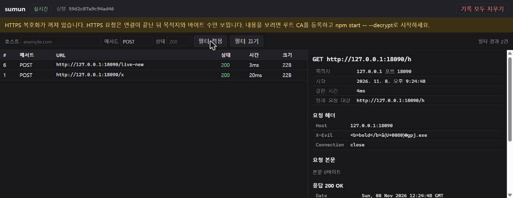

# [UI-5] 화면        커밋: c22b235..(이 문서 커밋)

## 한 줄 요약
이제 **브라우저로 대시보드를 볼 수 있습니다.** 목록이 실시간으로 늘어나고, 줄을 누르면 요청·응답의 헤더와 본문이 보이고, 호스트·메서드·상태로 거를 수 있습니다. 기다리던 UI 큰 단위 테스트(UI-T) 2개도 이제 실제로 돌고 통과합니다.

(위: 메서드 필터 `POST`로 2건만 남긴 목록, 오른쪽은 헤더에 `<b>bold</b>`가 든 기록의 상세 — 굵은 글씨가 아니라 글자 그대로 보입니다.)

## 화면 구성
| 부분 | 하는 일 |
|---|---|
| 머리 | 연결 상태(실시간 / 끊김 — 다시 연결 중), 실행 식별자, "기록 모두 지우기"(두 번 눌러야 지워짐) |
| 노란 안내 | 복호화가 꺼져 있으면 "HTTPS는 목적지와 바이트 수만 보입니다 — `--decrypt`로" (STO 결정 4) |
| 필터 | 호스트·메서드·상태. 서버의 필터 규칙(STO-3)을 그대로 씁니다 — 화면에 규칙을 다시 짜지 않았습니다 |
| 목록 | 최신이 위. 화면에는 최근 1,000줄까지(나머지는 "필터로 좁혀 보세요") |
| 상세 | 목적지(국제화 도메인은 ASCII와 유니코드 함께), 요청·응답 헤더 표, 본문(텍스트 / 16진 전환) |

## 왜 이렇게 만들었나 (보안 — 기록 내용이 화면에서 "실행"되지 않게)
기록에는 남이 만든 글자가 들어 있습니다. 어떤 사이트가 URL이나 헤더에 `<script>`를 넣어 두면, 화면이 그것을 HTML로 넣는 순간 **대시보드 출처에서 실행**되어 모든 기록(쿠키 포함)이 털립니다.

- **글자는 `textContent`로만 넣습니다**(U19). `innerHTML` 같은 "HTML로 해석하는" 방법은 코드에 아예 없습니다. 테스트가 소스에서 이런 패턴을 찾아 막습니다.
- **기록으로 링크·이미지를 만들지 않습니다**(U22). `javascript:` 링크 같은 함정이 생기지 않습니다.
- **숨은 문자를 보이게 합니다**(D-14, U25·U26). 예: `abc‮gpj.exe`는 실제로는 `abc` + U+202E(글자 방향 뒤집기) + `gpj.exe`인데, 화면에는 `exe.jpg`처럼 보입니다. 대시보드는 이것을 `abc⟨U+202E⟩gpj.exe`로 보입니다. 터미널 색을 바꾸는 ESC, 폭이 없는 문자도 같습니다.
- **비슷하게 생긴 도메인**(U26): `xn--80ak6aa92e.com`은 키릴 문자로 쓴 `аррӏе.com`(apple.com처럼 보임)입니다. 화면에 둘을 함께 보여서 알아볼 수 있게 했습니다.
- **헤더 이름을 객체 키로 쓰지 않습니다**(U24). 헤더 이름이 `__proto__`여도 그냥 데이터입니다.
- **브라우저에 남기지 않습니다**(D-11, U50): 쿠키·localStorage를 쓰지 않고, 모든 요청은 캐시하지 않습니다(`no-store`).
- **외부 자원 없음**(U18): CDN·외부 글꼴·라이브러리가 없습니다. 파일 셋(`app.js`, `view.js`, `app.css`)이 전부입니다.
- 이 주소에 다른 앱이 남긴 **서비스 워커**가 있으면 알리고 해제합니다(U49).

## 파일이 둘로 나뉜 이유
- `view.js`: 화면 없이 돌 수 있는 함수들(숨은 문자 표시, punycode 풀기, 16진, 목록 모델, SSE 읽기). **Node 테스트가 직접 확인합니다.**
- `app.js`: 버튼·표를 만드는 부분. Node에는 브라우저 화면이 없어서, 소스 검사(금지 패턴)와 **실제 브라우저 실측**으로 확인했습니다.

## 실제로 해 본 것 (Chrome, `npm.cmd start -- --port 18080`, 목적지는 127.0.0.1:18090)
| 확인 | 결과 |
|---|---|
| ① curl로 보낸 요청이 목록에 | 5건(POST /x, GET 들) ✅ |
| ② 줄을 누르면 상세 | `Cookie: k=CURL-COOKIE`, 요청 본문 `curl-body`, 응답 본문 `upstream-saw:curl-body` ✅ |
| ③ 페이지를 그대로 둔 채 새 요청 | 새로고침 없이 `/live-new`가 목록에 나타남 ✅ |
| ④ 메서드 필터 `POST` | 2건만 남음(위 그림) ✅ |
| ⑤ 경로에 ``, 헤더에 `<b>bold</b>` + U+202E | 글자 그대로 보이고 실행되지 않음. 페이지에 ``·`<b>` 요소 0개, 콘솔 오류 0 ✅ — 다만 U+202E는 예상과 다르게 보였습니다(아래) |
| ⑥ "복호화 꺼짐" 안내 | 보임 ✅ |

## 이번에 알게 된 것 (솔직하게)
1. **자동화 도구로 연 페이지는 대시보드가 막았습니다**(403). Chrome 확장이 연 탭은 `Sec-Fetch-Site: cross-site`를 보냅니다. 대시보드는 "다른 사이트에서 온 요청"으로 보고 거절합니다. UI-1에서 정한 규칙(D-7)이 그대로 작동한 것입니다.
   - 실측은 그 403 페이지에서 **같은 페이지를 다시 불러오게** 해서(같은 출처 → `same-origin`) 진행했습니다.
   - **확인하실 것**: 터미널의 주소를 직접 누르거나 주소창에 붙여 넣으면 `none`이 가서 열릴 것으로 봅니다 [추측]. 자동화로는 주소창 입력을 흉내 낼 수 없어서 확인하지 못했습니다. UI 큰 단위 보고서 때 직접 열어 봐 주세요.
2. **헤더에 넣은 한글·특수 문자가 깨져 보입니다**: U+202E가 `â⟨U+0080⟩®`로 나왔습니다. 프록시(Node)는 헤더 바이트를 한 바이트씩 글자로 읽어서(latin1) UTF-8 문자 하나가 세 글자가 됩니다. 방향 뒤집기는 일어나지 않으니 안전에는 문제가 없지만, 보기에는 나쁩니다 → UI 보고서 결정 항목.
3. **경로에는 U+202E를 넣을 수 없었습니다**: 프록시가 ASCII가 아닌 요청 대상을 400으로 거절합니다. 그래서 예상 ⑤의 "경로의 U+202E" 부분은 해 볼 수 없었습니다(불일치로 기록).
4. 커밋 명령에 셸 변수 설정을 섞었다가 hook이 막았습니다(규칙 D — 의도한 보수적 동작). 명령을 둘로 나눴습니다.

## 확인한 것
| 예상 | 결과 |
|---|---|
| E188 구현 전 새 테스트 모두 assertion 실패, 회귀 통과 | 일치 — 16개 AssertionError, 오류 0, 회귀 1 통과 [확인됨] |
| E189 `npm test` 실패 0, UI 대기 0 | 일치 — 773개 모두 통과, 대기 0, 81초 [확인됨] |
| E190 브라우저 여섯 가지 | **불일치** — ①②③④⑥과 ⑤의 "실행되지 않음"은 확인. ⑤의 "경로의 U+202E가 ⟨U+202E⟩로" 부분은 프록시가 400으로 막아 할 수 없었고, 헤더에서는 위 2번처럼 보였습니다 [확인됨] |

## UI 보고서에 올릴 결정 (추천으로 진행)
| 정한 것 | 다른 선택지 |
|---|---|
| UI-5를 나눠 **UI-5b**(이미지 미리보기·압축 풀기·내려받기)를 새로 둠. U21·U28을 옮김 | 한 PR로 |
| 토큰을 주소의 `#`에 그대로 둠(새로고침해도 됨) | 읽은 뒤 주소에서 지움(화면 공유 때 덜 보이지만 새로고침하면 토큰을 잃음) |
| 화면 목록 1,000줄, 본문 텍스트 256KiB·16진 64KiB까지 | 가상 스크롤로 전부 |
| 필터가 켜져 있으면 알림마다 서버에서 다시 받음(0.3초씩 묶음) | 브라우저에 필터 규칙을 복사 |
| 헤더의 비ASCII가 latin1로 깨져 보임 — 지금은 그대로 | 화면에서 UTF-8로 다시 풀어 보이기(UI-5b) |
| 확장·다른 앱이 연 탭은 403(D-7 그대로) | `Sec-Fetch-Site: cross-site`인 **페이지(HTML)** 요청만 허용(데이터 API는 토큰이 지킴) |

## 먼저 볼 코드
- `src/dashboard/public/app.js:19` — `el`: 요소를 만들고 글자는 textContent로만
- `src/dashboard/public/app.js:235` — `handleMessage`: 실시간 알림 처리(hello면 목록 다시 받기)
- `src/dashboard/public/app.js:261` — `stream`: fetch로 SSE 읽기, 끊기면 다시 연결
- `src/dashboard/public/app.js:367` — `select`: 상세 그리기
- `src/dashboard/public/app.js:321` — `bodySection`: 본문 텍스트/16진
- `src/dashboard/public/view.js:19` — `showHidden`: 숨은 문자를 ⟨U+XXXX⟩로
- `src/dashboard/public/view.js:78` — `hostLabel`: punycode 도메인을 유니코드와 함께
- `src/dashboard/public/view.js:196` — `createModel`: 목록 모델(완료를 진행 중이 덮지 않음)
- `src/dashboard/server.ts:179` — `/api/ping`의 `decrypt`
